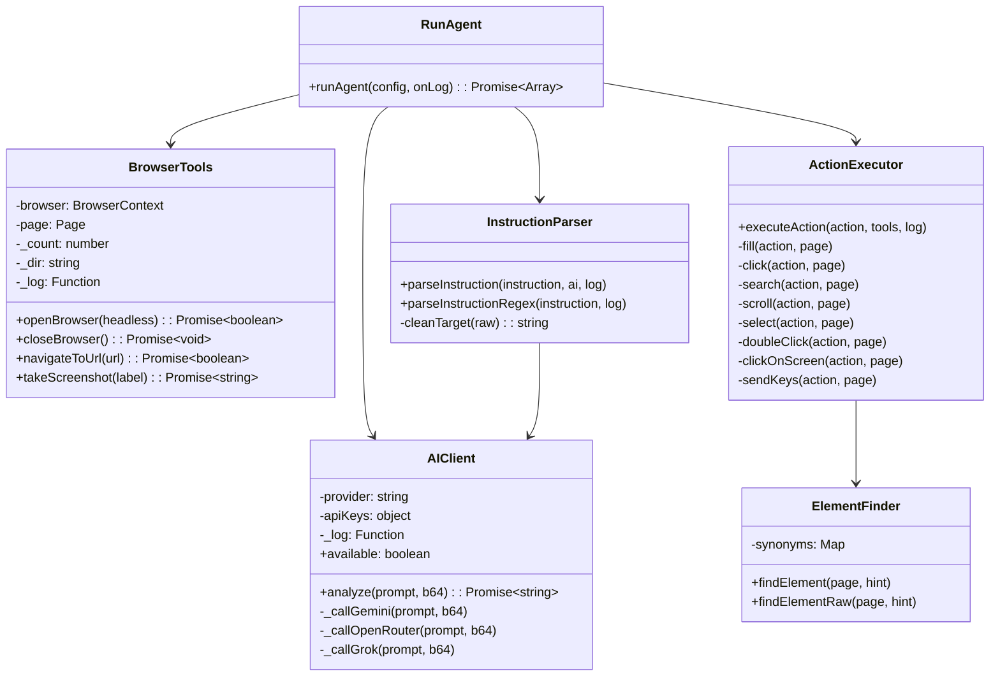
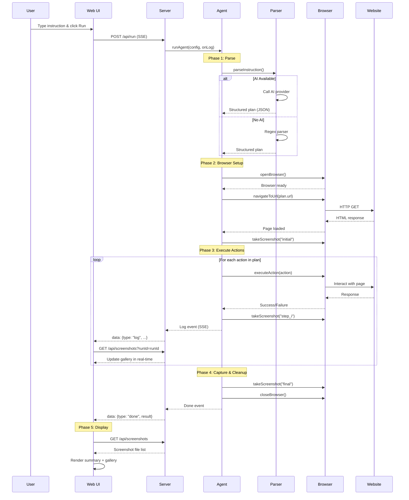
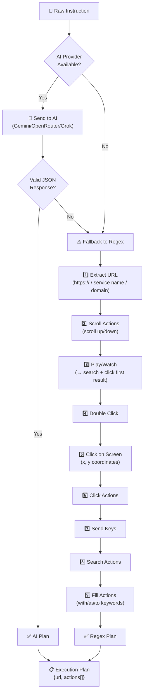
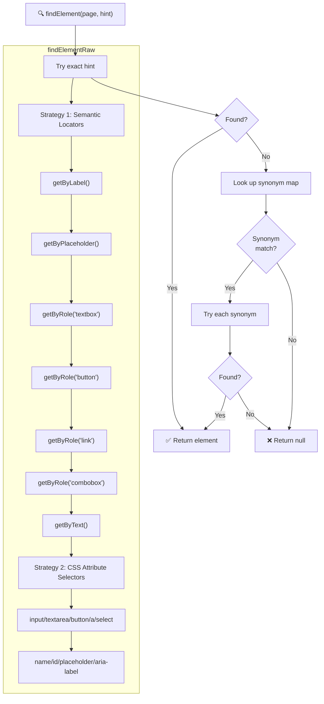
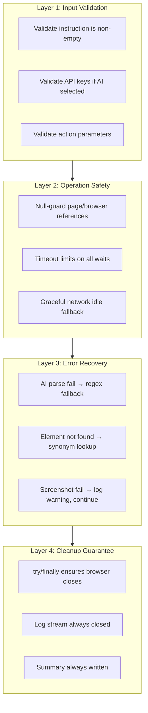

# Architecture Document — Website Automation Agent

## 1. System Overview

The Website Automation Agent is a Node.js application that converts **natural language instructions** into **automated browser actions** using Playwright. It features a web-based control panel, real-time log streaming via Server-Sent Events (SSE), and optional AI-powered instruction parsing.

```mermaid
graph TB
    subgraph User Layer
        UI["🖥 Web UI<br/>index.html"]
        CLI["⌨️ CLI<br/>node agent.js"]
    end

    subgraph Server Layer
        SRV["🌐 Express Server<br/>server.js"]
        SSE["📡 SSE Stream"]
        API["🔌 REST API"]
    end

    subgraph Agent Core
        AGT["🤖 Agent Engine<br/>agent.js"]
        PRS["📝 Instruction Parser"]
        FND["🔍 Element Finder"]
        EXC["⚡ Action Executor"]
    end

    subgraph External
        AI["🧠 AI Providers<br/>Gemini / OpenRouter / Grok"]
        BRW["🌐 Chromium Browser<br/>Playwright"]
        WEB["🌍 Target Websites"]
    end

    UI -->|POST /api/run| SRV
    CLI -->|direct call| AGT
    SRV -->|runAgent()| AGT
    SRV -->|SSE| SSE
    SRV -->|REST| API
    SSE -->|real-time logs| UI
    API -->|screenshots| UI

    AGT --> PRS
    AGT --> FND
    AGT --> EXC

    PRS -.->|optional| AI
    EXC --> BRW
    BRW --> WEB
```

---

## 2. Design Goals

| Goal | Decision |
|------|----------|
| Work without an API key | Regex-based parser as the primary strategy; AI is optional |
| Support multiple free AI providers | Unified `AIClient` class with provider abstraction |
| Modular and testable | Each browser action is an isolated function |
| Easy demonstration | Verbose logging + screenshot trail + web UI |
| Graceful error handling | Every operation wrapped in try/catch; never crash |
| Session persistence | Persistent browser profile for login state reuse |

---

## 3. Technology Stack

| Component | Choice | Reason |
|---|---|---|
| Language | JavaScript (Node.js 18+) | Playwright has first-class JS support; `fetch` is built-in |
| Browser Automation | Playwright | Async-native, reliable, excellent selector engine |
| HTTP Server | Express.js | Minimal, well-documented, SSE-compatible |
| AI Providers | Gemini / OpenRouter / Grok | All offer free tiers; REST API integration |
| Frontend | Vanilla HTML/CSS/JS | Zero build step; works with any browser |
| Logging | Custom logger (fs + console) | Zero extra deps; writes to file and streams via SSE |

---

## 4. Module Architecture



---

## 5. Execution Flow

### 5.1 Complete Lifecycle



### 5.2 Instruction Parsing Pipeline



### 5.3 Element Detection Strategy



---

## 6. Error Handling Architecture

The agent implements a **defense-in-depth** error handling strategy:



### Error Handling by Component

| Component | Failure Mode | Handling |
|---|---|---|
| **AI Client** | Bad API key / quota exceeded | Logs warning, returns empty → falls back to regex |
| **AI Client** | Malformed JSON response | Catches `SyntaxError`, falls back to regex |
| **AI Client** | Network timeout | Catches error, logs, continues without AI |
| **Parser** | No URL found | Throws descriptive error with examples |
| **Browser** | Launch failure | Returns false, agent logs actionable error |
| **Browser** | User profile directory locked | Catches error, logs warning, falls back to unique temporary browser profile context |
| **Browser** | Navigation timeout | Returns false, agent can stop or continue |
| **Browser** | Network idle timeout | Logs warning, continues (page may still work) |
| **Element Finder** | Element not found | Returns null → action logs warning |
| **Element Finder** | Page closed mid-search | Catches error, returns null |
| **Action Executor** | Click intercepted (modal / overlay) | Catches click interception error, logs warning, falls back to forced click, then custom dispatchEvent click |
| **Action Executor** | Missing action parameters | Validates and returns false immediately |
| **Action Executor** | Playwright timeout | Catches, logs warning, returns false |
| **Screenshot** | Page unavailable | Returns placeholder string, doesn't crash |
| **Server** | Malformed request body | Returns HTTP 400 with error message |
| **Server** | SSE write after close | Checks `writableEnded` before writing |
| **Server** | Unhandled exception | Global error handler returns 500 |
| **Log Stream** | File write error | Catches silently, continues to console |

---

## 7. Data Flow

### 7.1 Instruction → Actions

```
User Input:
  "Open https://ui.shadcn.com/docs/forms/react-hook-form
   and fill Name as hello and Description as bye"

      ↓ parseInstructionRegex()

Execution Plan:
  {
    url: "https://ui.shadcn.com/docs/forms/react-hook-form",
    actions: [
      { type: "fill", target: "Name",        value: "hello" },
      { type: "fill", target: "Description",  value: "bye"   }
    ]
  }

      ↓ executeAction() × 2

Action Log:
  [
    { action: "open_browser",     detail: "Chromium launched",      success: true  },
    { action: "navigate_to_url",  detail: "https://ui.shad...",     success: true  },
    { action: "take_screenshot",  detail: "001_initial_page.png",   success: true  },
    { action: "fill",             detail: "fill:Name→hello",        success: true  },
    { action: "take_screenshot",  detail: "002_step_001_fill.png",  success: true  },
    { action: "fill",             detail: "fill:Description→bye",   success: true  },
    { action: "take_screenshot",  detail: "003_step_002_fill.png",  success: true  },
    { action: "take_screenshot",  detail: "004_final_state.png",    success: true  }
  ]
```

### 7.2 Server-Sent Events Flow

```
Client (UI)                    Server                     Agent
    |                            |                          |
    |--- POST /api/run --------->|                          |
    |                            |--- runAgent() ---------->|
    |                            |                          |
    |<-- data: {log, info} ------|<---- onLog(info) --------|
    |<-- data: {log, info} ------|<---- onLog(info) --------|
    |<-- data: {log, warning} ---|<---- onLog(warning) -----|
    |<-- data: {log, info} ------|<---- onLog(info) --------|
    |                            |                          |
    |<-- data: {done, result} ---|<---- return actionLog ---|
    |                            |                          |
    |--- GET /api/screenshots -->|                          |
    |<-- ["/screenshots/..."] ---|                          |
```

### 7.3 Page Load Recovery Flow

When the Web UI is loaded or refreshed, it restores the state of the last run automatically using the following sequence:

```
Client (UI)                    Server                     FS (Logs & Screenshots)
    |                            |                                   |
    |--- GET /api/latest ------->|                                   |
    |                            |--- read latest log & summary ---->|
    |                            |<-- {logs, summary, runId} --------|
    |<-- {runId, summary, logs} -|                                   |
    |                            |                                   |
    |--- GET /api/screenshots -->|                                   |
    |    (fallback latest run)   |--- read screenshot dir ---------->|
    |                            |<-- [img1, img2, ...] -------------|
    |<-- ["/screenshots/..."] ---|                                   |
```

---

## 8. Synonym Mapping

The element finder uses synonym mappings to handle variations in field naming:

| User Says | Also Tries |
|---|---|
| `bio` | more about you, about me, about, biography, description |
| `description` | bio, desc, more about you, about |
| `name` | username, full name, first name, user |
| `title` | subject, bug title, header |
| `email` | email address, e-mail, mail |
| `password` | pass, passwd, secret |
| `phone` | telephone, mobile, cell, phone number |
| `message` | comment, feedback, note, body |

---

## 9. File Descriptions

| File | Purpose | Key Exports |
|---|---|---|
| `agent.js` | Core automation engine — parser, element finder, executor, browser tools | `runAgent(config, onLog)` |
| `server.js` | Express HTTP server — SSE streaming, REST API, static file serving | *(starts server)* |
| `public/index.html` | Single-page web UI — instruction input, log terminal, screenshot gallery | *(frontend)* |
| `package.json` | npm metadata and dependencies | *(config)* |

---

## 10. Security Considerations

| Concern | Mitigation |
|---|---|
| API keys in transit | Keys are sent per-request, never stored on server |
| Browser profile data | Stored locally in `user_data/`, gitignored |
| Request size | Express `json` middleware limited to 1MB |
| Screenshot directory | Wiped clean before every new run |
| Sensitive logs | Log directory is gitignored |
